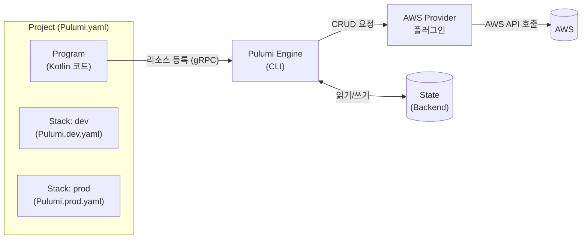
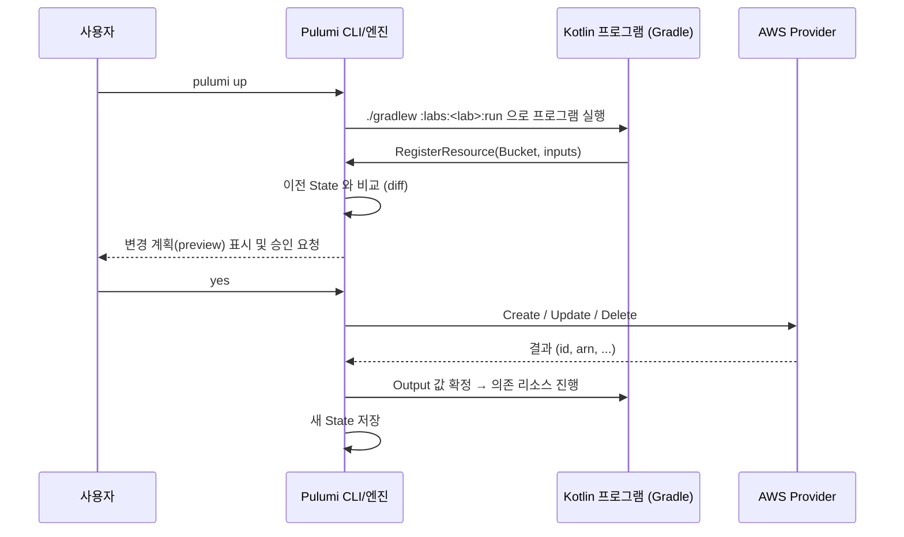

# 02. 핵심 개념

## 전체 그림



## Project

`Pulumi.yaml` 파일이 있는 디렉터리 하나가 **프로젝트**입니다. 이 저장소에서는 `labs/*` 각각이 프로젝트입니다.

```yaml
# labs/01-s3-bucket/Pulumi.yaml
name: lab01-s3-bucket        # 프로젝트 이름
runtime: java                # Kotlin 도 JVM 이므로 java 런타임 사용
config:
  aws:region:
    value: ap-northeast-2    # 모든 스택의 기본값
```

## Program

인프라를 선언하는 코드입니다. Kotlin 에서는 `Pulumi.run { ctx -> ... }` 블록 안에서 리소스 객체를 생성합니다.
객체를 "생성"하는 순간 실제 AWS 리소스가 만들어지는 것이 아니라, **엔진에 "이 리소스가 있어야 한다"고 등록**하는 것입니다.

## Stack

같은 프로그램을 **서로 다른 설정으로 배포한 독립 인스턴스**입니다. 보통 `dev`, `stg`, `prod` 처럼 환경별로 만듭니다.

- 스택마다 별도의 **상태(State)** 와 **설정 파일**(`Pulumi.<stack>.yaml`)을 가집니다.
- 전체 이름은 `<organization>/<project>/<stack>` 입니다. (로컬/S3 백엔드에서는 organization 이 `organization` 으로 고정)

```bash
pulumi stack init dev      # 스택 생성
pulumi stack ls            # 스택 목록
pulumi stack select prod   # 현재 스택 전환
```

## Resource

Pulumi 가 관리하는 인프라 단위입니다.

| 종류 | 설명 | 예 |
|---|---|---|
| **CustomResource** | 프로바이더가 실제로 CRUD 하는 리소스 | `Bucket`, `Vpc`, `Instance` |
| **ComponentResource** | 여러 리소스를 묶은 논리적 단위 (Lab 05) | `StaticWebsite` |
| **Provider Resource** | 프로바이더 자체 설정 (리전, 계정을 바꿀 때) | `com.pulumi.aws.Provider` |

모든 리소스 생성자는 같은 모양입니다.

```kotlin
Bucket(
    "lab01-bucket",            // 1) 논리 이름: 스택 안에서 고유. URN 의 일부
    BucketArgs.builder()...,   // 2) 입력값(Args)
    CustomResourceOptions...,  // 3) 옵션(선택): dependsOn, parent, protect, provider ...
)
```

### 논리 이름과 물리 이름 (Auto-naming)

`"lab01-bucket"` 은 Pulumi 안에서 쓰는 **논리 이름**입니다. 실제 AWS 버킷 이름(물리 이름)을 지정하지 않으면
Pulumi 가 `lab01-bucket-a1b2c3d` 처럼 **랜덤 접미사**를 붙입니다. 덕분에

- 여러 스택을 같은 계정에 배포해도 이름이 충돌하지 않고,
- 교체(replace)가 필요할 때 "새 리소스 생성 → 기존 리소스 삭제" 순서로 무중단 교체가 가능합니다.

### URN

모든 리소스는 고유 식별자 URN 을 가집니다.

```
urn:pulumi:dev::lab01-s3-bucket::aws:s3/bucket:Bucket::lab01-bucket
           스택  프로젝트          리소스 타입             논리 이름
```

논리 이름을 바꾸면 URN 이 바뀌므로 Pulumi 는 **삭제 후 재생성**으로 판단합니다. 이름을 바꾸고 싶다면 `aliases` 옵션을 사용하세요.

## Input 과 Output — 가장 중요한 개념

리소스의 속성 중 상당수는 **배포가 끝나야 알 수 있는 값**입니다 (버킷 ARN, EC2 퍼블릭 IP 등).
Pulumi 는 이런 값을 `Output<T>` 로 표현합니다. "미래에 확정될 값 + 의존성 정보"를 담은 컨테이너로 생각하면 됩니다.

```kotlin
val bucket = Bucket("site", ...)
val arn: Output<String> = bucket.arn()       // 아직 값이 없다!

// (X) 잘못된 사용: toString() 은 실제 값이 아니다
val wrong = "${bucket.arn()}/*"

// (O) applyValue 로 "값이 확정되면" 변환
val policy: Output<String> = bucket.arn().applyValue { arn -> """{"Resource": "$arn/*"}""" }

// (O) 여러 Output 을 문자열로 합칠 때
val url: Output<String> = Output.format("http://%s", website.websiteEndpoint())

// (O) 다른 리소스의 입력으로 그대로 전달 → 의존성이 자동 기록된다
BucketPolicy("policy", BucketPolicyArgs.builder().bucket(bucket.id())...)
```

| 메서드 | 용도 |
|---|---|
| `applyValue { }` | 값을 일반 값으로 변환 (`Output<A>` → `Output<B>`) |
| `apply { }` | 값을 다른 Output 으로 변환 (flatMap) |
| `Output.all(...)`, `Output.tuple(...)` | 여러 Output 결합 |
| `Output.format(...)` | 문자열 템플릿 |
| `Output.of(x)`, `Output.ofSecret(x)` | 일반 값을 Output(또는 시크릿)으로 감싸기 |

> **핵심**: `Output` 을 다른 리소스의 입력으로 넘기면, Pulumi 가 그 관계를 보고 **생성 순서(의존성 그래프)를 자동 결정**합니다.
> 코드 작성 순서가 아니라 데이터 흐름이 배포 순서를 결정합니다.

## State 와 Backend

Pulumi 는 "마지막으로 배포한 결과"를 **상태(State)** 로 저장하고, 다음 배포 때 프로그램이 선언한 상태와 비교합니다.

| Backend | 로그인 명령 | 특징 |
|---|---|---|
| Pulumi Cloud | `pulumi login` | 기본값. 히스토리/웹 콘솔/동시성 잠금 제공 |
| 로컬 파일 | `pulumi login --local` | `~/.pulumi` 에 저장. 개인 실습용 |
| S3 | `pulumi login s3://my-state-bucket` | 자체 관리. 팀에서 Pulumi Cloud 없이 사용할 때 |

> 상태 파일에는 리소스 속성이 모두 들어 있으므로 **절대 Git 에 커밋하지 말고** 접근 권한을 관리하세요.
> 시크릿 값은 상태 안에서도 암호화되어 저장됩니다 (Lab 03).

## Config 와 Secret

스택별로 달라지는 값은 코드가 아니라 **설정**으로 분리합니다.

```bash
pulumi config set instanceType t3.small            # Pulumi.<stack>.yaml 에 평문 저장
pulumi config set --secret dbPassword 'p@ss'       # 암호화되어 저장
pulumi config set aws:region us-east-1             # 프로바이더 설정 (네임스페이스 aws:)
```

## `pulumi up` 이 실행되는 과정



| 명령 | 동작 |
|---|---|
| `pulumi preview` | 변경 계획만 계산 (실제 변경 없음) |
| `pulumi up` | 계획 계산 후 적용 |
| `pulumi refresh` | 실제 클라우드 상태를 읽어 State 갱신 (drift 감지) |
| `pulumi destroy` | 스택의 모든 리소스 삭제 |
| `pulumi stack output` | export 한 값 조회 |

---

| ← 이전글 | 목차 | 다음글 → |
|:---|:---:|---:|
| [01. Pulumi 란 무엇인가](01-what-is-pulumi.md) | [목차](../README.md#문서-학습-순서) | [03. Kotlin 으로 Pulumi 사용하기](03-pulumi-with-kotlin.md) |
