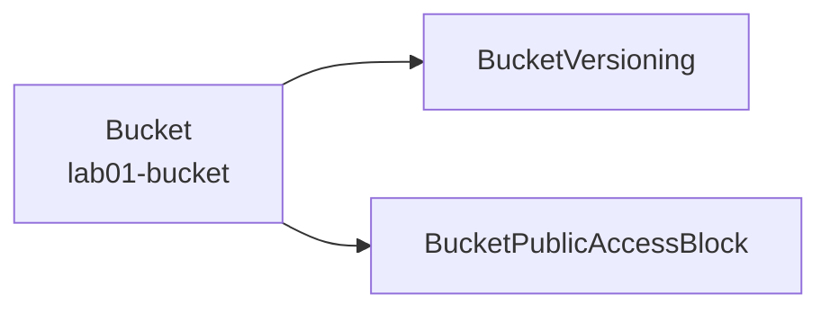

# 05. Lab 01 - S3 버킷 만들기

> 코드: [`labs/01-s3-bucket`](../labs/01-s3-bucket)

## 목표

- 첫 Pulumi 프로그램을 배포하고 `preview → up → output → destroy` 흐름을 익힌다.
- 리소스 간 연결(`bucket.id()`)이 의존성이 되는 것을 확인한다.
- Auto-naming 과 스택 출력(export)을 이해한다.

## 만들 리소스



| 리소스 | 타입 토큰 | 설명 |
|---|---|---|
| `Bucket` | `aws:s3/bucket:Bucket` | 비공개 버킷 (태그 포함) |
| `BucketVersioning` | `aws:s3/bucketVersioning:BucketVersioning` | 버전 관리 활성화 |
| `BucketPublicAccessBlock` | `aws:s3/bucketPublicAccessBlock:BucketPublicAccessBlock` | 퍼블릭 접근 전면 차단 |

## 코드 살펴보기

`S3BucketStack.kt` 의 핵심:

```kotlin
val bucket = Bucket(
    "lab01-bucket",
    BucketArgs.builder()
        .forceDestroy(true)                 // 실습용: 객체가 있어도 삭제 가능
        .tags(commonTags(ctx))              // Project / Stack / ManagedBy 태그
        .build()
)

BucketVersioning(
    "lab01-bucket-versioning",
    BucketVersioningArgs.builder()
        .bucket(bucket.id())                // ← Output 연결 = 의존성
        .versioningConfiguration(
            BucketVersioningVersioningConfigurationArgs.builder().status("Enabled").build()
        )
        .build()
)

ctx.export("bucketName", bucket.bucket())
ctx.export("bucketArn", bucket.arn())
```

> AWS provider v7 부터 버전 관리, 웹사이트, 퍼블릭 접근 차단 같은 S3 설정은 **별도 리소스**로 분리하는 것이 표준입니다.
> (`Bucket` 의 인라인 `versioning`, `website` 속성은 deprecated)

## 실행

```bash
cd labs/01-s3-bucket

pulumi stack init dev
pulumi preview
```

출력 예시:

```
     Type                                    Name                              Plan
 +   pulumi:pulumi:Stack                     lab01-s3-bucket-dev               create
 +   ├─ aws:s3:Bucket                        lab01-bucket                      create
 +   ├─ aws:s3:BucketVersioning              lab01-bucket-versioning           create
 +   └─ aws:s3:BucketPublicAccessBlock       lab01-bucket-public-access-block  create

Resources:
    + 4 to create
```

```bash
pulumi up                         # 계획 확인 후 'yes'
pulumi stack output               # bucketName, bucketArn 확인
pulumi stack output bucketName

aws s3api get-bucket-versioning --bucket "$(pulumi stack output bucketName)"
# { "Status": "Enabled" }
```

## 실험해 보기

1. **변경(update)**: `commonTags` 에 `"Owner" to "me"` 를 추가하고 `pulumi up` → `~ update` 로 태그만 변경되는지 확인
2. **교체(replace)**: `BucketArgs` 에 `.bucket("my-fixed-name-<랜덤>")` 을 추가하고 `pulumi preview` → 이름은 변경 불가 속성이라 `+-replace` 로 표시됨
3. **Drift**: AWS 콘솔에서 태그를 직접 지운 뒤 `pulumi refresh` → Pulumi 가 차이를 감지
4. **보호**: `CustomResourceOptions.builder().protect(true).build()` 를 버킷에 추가 → `pulumi destroy` 가 거부되는지 확인

## 테스트

```bash
./gradlew :labs:01-s3-bucket:test
```

Mock 으로 태그, 버전 관리, 퍼블릭 차단, export 값을 검증합니다. ([11. 테스트](11-testing.md) 참고)

## 정리

```bash
pulumi destroy
pulumi stack rm dev
```

---

| ← 이전글 | 목차 | 다음글 → |
|:---|:---:|---:|
| [04. 실습 환경 준비](04-setup.md) | [목차](../README.md#문서-학습-순서) | [06. Lab 02 - S3 정적 웹사이트](06-lab02-static-website.md) |
