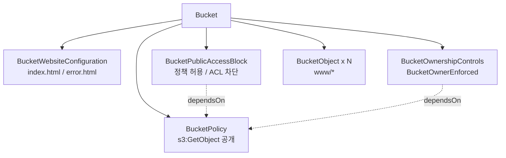

# 06. Lab 02 - S3 정적 웹사이트

> 코드: [`labs/02-static-website`](../labs/02-static-website)

## 목표

- `Output.applyValue` 로 아직 모르는 값(버킷 ARN)을 가공해 정책 JSON 을 만든다.
- `dependsOn` 으로 **데이터 흐름에 드러나지 않는 의존성**을 명시한다.
- 로컬 파일(`www/`)을 `FileAsset` 으로 업로드한다.

## 만들 리소스



## 코드 살펴보기

### 1. Output 가공 — 버킷 정책

```kotlin
BucketPolicy(
    "lab02-site-policy",
    BucketPolicyArgs.builder()
        .bucket(bucket.id())
        .policy(bucket.arn().applyValue { arn ->
            Either.ofLeft<String, PolicyDocumentArgs>(publicReadPolicy(arn))
        })
        .build(),
    CustomResourceOptions.builder()
        .dependsOn(publicAccess, ownership)
        .build()
)
```

- `bucket.arn()` 은 배포 후 확정되므로 `applyValue` 블록 안에서만 문자열로 다룰 수 있습니다.
- 버킷 정책은 **퍼블릭 접근 차단이 해제된 후**에만 적용됩니다. 하지만 `BucketPolicy` 는 `publicAccess` 의 Output 을
  입력으로 쓰지 않으므로 Pulumi 가 이 순서를 알 수 없습니다. 그래서 `dependsOn` 으로 명시합니다.
  (생략하면 병렬 생성 중 `AccessDenied` 가 날 수 있습니다.)

### 2. 파일 업로드

```kotlin
Files.walk(siteDir).use { it.filter { p -> p.isRegularFile() }.sorted().toList() }
    .map { file ->
        val key = siteDir.relativize(file).toString().replace('\\', '/')
        BucketObject(
            "lab02-object-$key",
            BucketObjectArgs.builder()
                .bucket(bucket.id())
                .key(key)
                .source(FileAsset(file.toString()))
                .contentType(ContentTypes.of(file))   // text/html 등을 지정해야 브라우저가 렌더링
                .build()
        )
    }
```

- 일반 Kotlin 코드(반복문, 파일 API)로 리소스 개수를 동적으로 결정합니다. 범용 언어 IaC 의 장점입니다.
- 파일 내용이 바뀌면 Pulumi 가 해시를 비교해 해당 객체만 갱신합니다.
- 프로그램의 작업 디렉터리는 lab 디렉터리이므로 `Path.of("www")` 로 접근합니다.

### 3. 여러 Output 합치기

```kotlin
ctx.export("websiteUrl", Output.format("http://%s", website.websiteEndpoint()))
```

## 실행

```bash
cd labs/02-static-website
pulumi stack init dev
pulumi up
curl "$(pulumi stack output websiteUrl)"
curl "$(pulumi stack output websiteUrl)/no-such-page"   # error.html (404)
```

> S3 웹사이트 엔드포인트는 HTTP 만 지원합니다. HTTPS 와 커스텀 도메인이 필요하면 CloudFront + ACM 을 앞에 둡니다.

## 실험해 보기

1. `www/index.html` 내용을 수정하고 `pulumi up` → 객체 1개만 `~ update` 되는지 확인
2. `www/about.html` 을 추가 → `+ create` 1개
3. `dependsOn(...)` 을 제거하고 `pulumi destroy && pulumi up` 을 반복해 보기 (경합 상황 관찰)
4. `pulumi stack graph graph.dot` 으로 의존성 그래프를 파일로 출력해 보기

## 정리

```bash
pulumi destroy
pulumi stack rm dev
```

---

| ← 이전글 | 목차 | 다음글 → |
|:---|:---:|---:|
| [05. Lab 01 - S3 버킷](05-lab01-s3-bucket.md) | [목차](../README.md#문서-학습-순서) | [07. Lab 03 - Config 와 Secret](07-lab03-config-secrets.md) |
