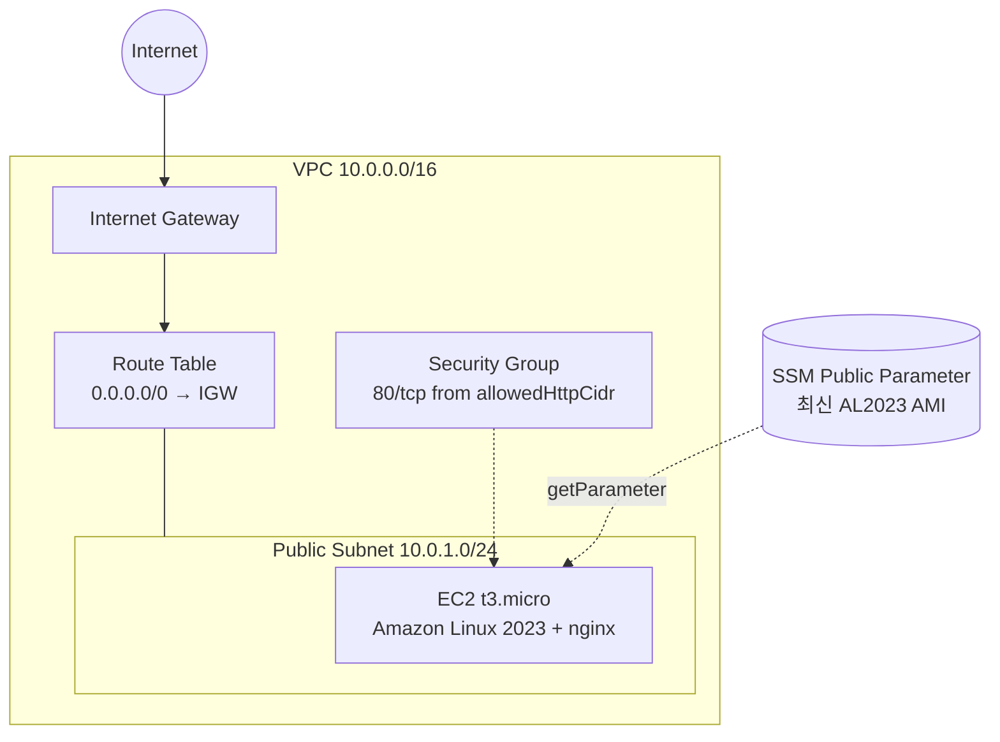

# 08. Lab 04 - VPC 와 EC2 웹 서버

> 코드: [`labs/04-vpc-ec2`](../labs/04-vpc-ec2)
>
> **비용 주의**: EC2 인스턴스(t3.micro)와 퍼블릭 IPv4 주소가 시간당 과금됩니다. 실습 후 바로 `pulumi destroy` 하세요.

## 목표

- 여러 리소스를 Output 으로 연결해 **의존성 그래프가 자동으로 만들어지는 것**을 확인한다.
- **데이터 소스(invoke)** 로 최신 AMI ID 를 조회한다.
- 다음 Lab(StackReference)에서 사용할 네트워크 정보를 export 한다.

## 아키텍처



생성 순서는 코드 순서가 아니라 데이터 흐름으로 결정됩니다.

```
Vpc ─┬─> InternetGateway ──> RouteTable ─┐
     ├─> Subnet ─────────────────────────┼─> RouteTableAssociation
     │        └──────────────────────────┼─> Instance
     └─> SecurityGroup ──────────────────┘      ↑
SsmFunctions.getParameter (AMI) ────────────────┘
```

## 코드 살펴보기

### 1. 데이터 소스로 AMI 조회

```kotlin
const val AL2023_AMI_PARAMETER = "/aws/service/ami-amazon-linux-latest/al2023-ami-kernel-default-x86_64"

val amiId: Output<String> = SsmFunctions
    .getParameter(GetParameterArgs.builder().name(AL2023_AMI_PARAMETER).build())
    .applyValue { it.value() }
```

AMI ID 는 리전마다, 시점마다 다르므로 하드코딩하지 않습니다. AWS 가 관리하는 공개 SSM 파라미터를 조회하면
항상 최신 Amazon Linux 2023 AMI 를 얻을 수 있습니다. 조회 결과도 `Output` 입니다.

### 2. EC2 인스턴스

```kotlin
Instance(
    "lab04-web-server",
    InstanceArgs.builder()
        .ami(amiId)
        .instanceType(settings.instanceType)
        .subnetId(publicSubnet.id())
        .vpcSecurityGroupIds(webSg.id().applyValue { listOf(it) })
        .userData(UserData.nginx(stack))
        .userDataReplaceOnChange(true)      // user data 변경 시 인스턴스 교체
        .metadataOptions(InstanceMetadataOptionsArgs.builder().httpTokens("required").build())  // IMDSv2
        .build()
)
```

### 3. Lab 06 을 위한 export

```kotlin
ctx.export("vpcId", vpc.id())
ctx.export("vpcCidr", vpc.cidrBlock())
ctx.export("publicSubnetId", publicSubnet.id())
ctx.export("url", Output.format("http://%s", server.publicIp()))
```

## 실행

```bash
cd labs/04-vpc-ec2
pulumi stack init dev

# (권장) HTTP 접근을 내 IP 로 제한
pulumi config set allowedHttpCidr "$(curl -s https://checkip.amazonaws.com)/32"

pulumi up
# 인스턴스 부팅과 nginx 설치에 1~2분 정도 걸립니다.
curl "$(pulumi stack output url)"
```

> Lab 06 을 이어서 진행할 예정이면 **이 스택을 아직 삭제하지 마세요.**

## 실험해 보기

1. `pulumi config set instanceType t3.small && pulumi preview` → 인스턴스 타입 변경은 `~ update`(재시작)
2. `UserData.kt` 의 HTML 을 수정 → `userDataReplaceOnChange(true)` 때문에 `+-replace`
3. `pulumi stack --show-urns` 로 각 리소스의 URN 확인
4. 잘못된 CIDR(`pulumi config set allowedHttpCidr 1.2.3.4`)로 검증 실패 확인

## 정리

```bash
pulumi destroy
pulumi stack rm dev
```

---

| ← 이전글 | 목차 | 다음글 → |
|:---|:---:|---:|
| [07. Lab 03 - Config 와 Secret](07-lab03-config-secrets.md) | [목차](../README.md#문서-학습-순서) | [09. Lab 05 - ComponentResource](09-lab05-component-resource.md) |
