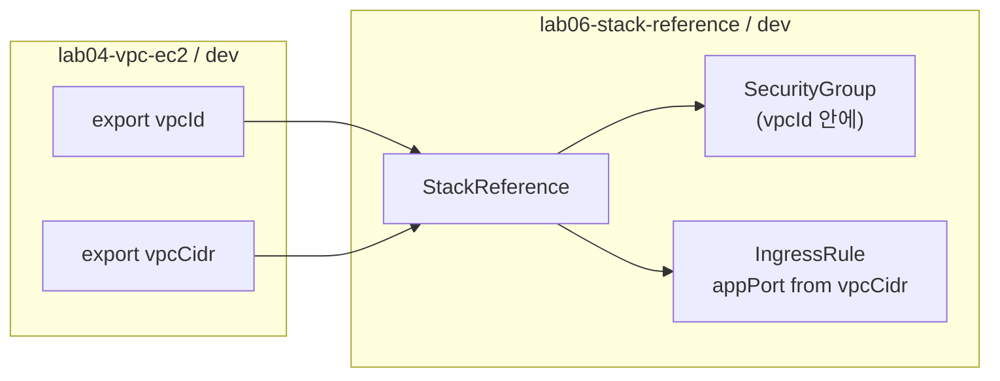

# 10. Lab 06 - StackReference 로 스택 간 값 공유

> 코드: [`labs/06-stack-reference`](../labs/06-stack-reference)
>
> **사전 조건**: [Lab 04](08-lab04-vpc-ec2.md) 의 `dev` 스택이 배포되어 있어야 합니다.

## 목표

- 인프라를 **수명 주기와 소유 팀 단위로 스택을 분리**하는 이유를 이해한다.
- `StackReference` 로 다른 스택의 출력값을 읽어 사용한다.

## 왜 스택을 나눌까?

| 스택 | 변경 빈도 | 소유 | 예 |
|---|---|---|---|
| 네트워크 (Lab 04) | 낮음 | 플랫폼 팀 | VPC, 서브넷, 라우팅 |
| 애플리케이션 (Lab 06) | 높음 | 서비스 팀 | 보안 그룹, 컨테이너, DB |

하나의 거대한 스택은 배포가 느리고, 작은 변경에도 영향 범위(blast radius)가 커집니다.
스택을 나누면 **네트워크는 export 로 계약(interface)을 공개**하고, 애플리케이션은 그 계약만 읽어 사용합니다.



## 코드 살펴보기

```kotlin
val network = StackReference(settings.networkStack)   // 예: "organization/lab04-vpc-ec2/dev"
val vpcId = network.requireString("vpcId")
val vpcCidr = network.requireString("vpcCidr")

val appSg = SecurityGroup("lab06-app-sg", SecurityGroupArgs.builder().vpcId(vpcId)...)

SecurityGroupIngressRule(
    "lab06-app-ingress",
    SecurityGroupIngressRuleArgs.builder()
        .securityGroupId(appSg.id())
        .ipProtocol("tcp").fromPort(settings.appPort).toPort(settings.appPort)
        .cidrIpv4(vpcCidr)
        .build()
)
```

- `requireOutput` 은 값이 없으면 배포를 실패시킵니다 (`output` 은 없으면 null).
- 참조한 출력이 시크릿이면 결과도 시크릿으로 유지됩니다.
- `requireString` 은 `Output<?>` 를 `Output<String>` 으로 좁히는 Kotlin 확장 함수입니다 (`StackReferences.kt`).
- 보안 그룹 규칙은 인라인 `ingress` 대신 **독립 리소스**(`aws.vpc.SecurityGroupIngressRule`)로 관리하는 것이 AWS provider 의 권장 방식입니다.

## 실행

```bash
# 1) 네트워크 스택 (Lab 04) 이 배포되어 있는지 확인
cd labs/04-vpc-ec2
pulumi stack select dev
pulumi stack output vpcId

# 2) 애플리케이션 스택
cd ../06-stack-reference
pulumi stack init dev

# 로컬/S3 백엔드
pulumi config set networkStack organization/lab04-vpc-ec2/dev
# Pulumi Cloud 백엔드 (본인 계정/조직 이름 사용)
# pulumi config set networkStack <your-org>/lab04-vpc-ec2/dev

pulumi up
pulumi stack output
```

## 실험해 보기

1. Lab 04 의 `vpcCidr` export 를 주석 처리하고 Lab 04 를 `up` → Lab 06 `preview` 가 실패하는지 확인 (계약 파괴 감지)
2. `pulumi config set appPort 9090` → 규칙만 교체되는지 확인
3. Lab 06 을 먼저 destroy 해야 Lab 04 의 VPC 를 지울 수 있는 이유 생각해 보기 (SG 가 VPC 에 속해 있음)

## 정리 (순서 중요!)

```bash
# 의존하는 쪽(앱)부터 삭제
cd labs/06-stack-reference && pulumi destroy && pulumi stack rm dev
cd ../04-vpc-ec2           && pulumi destroy && pulumi stack rm dev
```

---

| ← 이전글 | 목차 | 다음글 → |
|:---|:---:|---:|
| [09. Lab 05 - ComponentResource](09-lab05-component-resource.md) | [목차](../README.md#문서-학습-순서) | [11. 인프라 코드 테스트](11-testing.md) |
